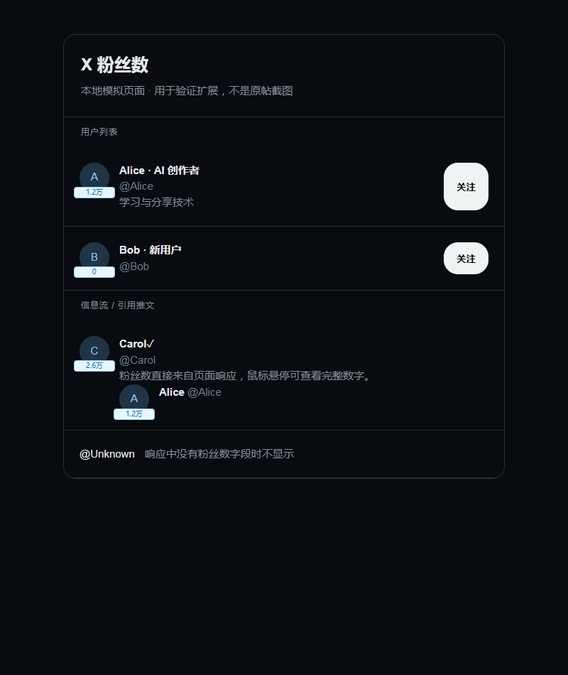

# X Follower Count · X 粉丝数

在 X 的信息流、关注列表和粉丝列表中，在用户头像下沿显示粉丝数浮层。

Chrome Manifest V3 扩展，零构建。复用页面自身请求中的用户数据，不需要 API Key、后台服务或导出 Cookie。

[下载 v1.0.3](https://github.com/felixwong1989/x-follower-count/releases/tag/v1.0.3) · [反馈问题](https://github.com/felixwong1989/x-follower-count/issues)



上图为扩展在模拟页面上的自动化测试截图，使用虚构账号与数据。

## 安装

1. 下载本仓库或 Release ZIP，并解压到一个固定位置。
2. 在 Chrome 打开 `chrome://extensions`，启用**开发者模式**。
3. 点击**加载已解压的扩展程序**，选择包含 `manifest.json` 的目录。
4. 刷新已登录的 X 页面，浏览信息流或用户关注/粉丝列表。

支持 Chrome 111 及以上。Edge 可通过 `edge://extensions` 加载。

升级时，用新版本覆盖原目录，在扩展卡片上点击刷新箭头，再刷新 X 页面。通过 GitHub 分发的解压版需要用户手动更新。

## 功能

- 在用户头像下沿显示蓝色 `17.4万` 标签；悬停可确认它是粉丝数并查看完整数字。
- 标签位于独立浮层，不参与姓名、用户名或时间戳的排版；随头像滚动，遮挡时隐藏。
- 悬停显示完整数字；真实 0 粉丝会显示，缺失数据不会被误显示为 0。
- 支持用户列表、推文作者、引用推文、滚动加载和虚拟列表复用。
- 支持当前 X 的 `core.screen_name` / `relationship_counts.followers`，兼容旧版 `legacy` 和 `public_metrics` 字段。
- 不额外请求补齐数据；最多在当前标签页内存中缓存 5,000 个用户。

## 原理

`network-core.js` / `network.js` 在页面 MAIN 环境读取已有 fetch 与 XHR 响应，并提取用户名与粉丝数。通过 `window.postMessage` 将这两个字段发送到 ISOLATED 环境，由 `core.js` / `content.js` 定位 DOM 并更新标签。

`MutationObserver` 处理动态加载，`style.css` 负责标签样式。MAIN 与 ISOLATED 使用不同脚本文件，避免跨环境的重复文件注入问题。

## 开发与测试

基础解析测试不需要安装第三方依赖：

```sh
npm test
```

浏览器测试使用隔离 Chromium 配置和模拟 X 响应：

```sh
npm install
npx playwright install chromium
npm run test:browser
```

可以通过 `PLAYWRIGHT_MODULE` 和 `PLAYWRIGHT_CHROMIUM_EXECUTABLE_PATH` 指定现有测试运行时。

## 打包 Release

Python 3 标准库即可打包，无需额外 Python 包：

```sh
python scripts/package.py
```

macOS/Linux 可使用 `python3 scripts/package.py`。输出为 `dist/x-follower-count-v1.0.3.zip`，`manifest.json` 位于 ZIP 根目录。ZIP 只包含运行扩展所需文件，不包含开发测试和模拟截图。

## 已验证的范围

1.0.3 将标签移到头像浮层，覆盖姓名链接含关联标识图片、用户名/时间戳换行的场景。旧版在 420px 与 280px 宽度的模拟推文中会让正文下移 20px；新版本在四种测试宽度下，标签出现、数字变化和隐藏都不改变推文布局。

- 6 项解析/清单测试和 8 组实际扩展浏览器测试通过。
- 实际 X Following 响应包含 50 个可解析用户。
- 使用真实用户行 DOM 与实际响应回放，15 个用户行均匹配到对应粉丝标签。
- 在真实搜索结果页面注入布局测试数字，姓名、正文和推文的边界框连续采样保持完全一致；此项只验证布局，不代表实时粉丝数。
- 真实登录态页面的显示脚本也已验证；修复版重新加载后的自动抓取、更多 X 路线和不同浏览器版本仍需要用户反馈。

## 限制与反馈

标签只显示页面已提供的数字。只有找到对应账号、且尺寸不小于 24px 的用户头像时才显示；无头像或过小头像的引用卡片暂不显示。X 改变响应字段或 DOM 后可能需要适配。

如果没有标签，先重新加载扩展并刷新 X，再检查扩展管理页中的错误。提交 Issue 时附上浏览器版本、扩展版本、发生问题的页面类型与错误信息；请使用模拟数据或去掉登录信息，勿提交 Cookie、Token、完整 HAR 或私人通信内容。

## 发布

GitHub 发布步骤、商店所缺材料以及许可证选项见 [发布指南](docs/PUBLISHING.md)。隐私说明见 [数据处理说明](docs/PRIVACY.md)。

此项目是根据 [原帖展示的功能](https://x.com/yiren_ai/status/2108490929787322455) 重新实现，不是作者原始源码。项目与 X / Twitter 官方无关联。

本仓库目前未配置开源许可证；许可证选择由项目发布者决定。
